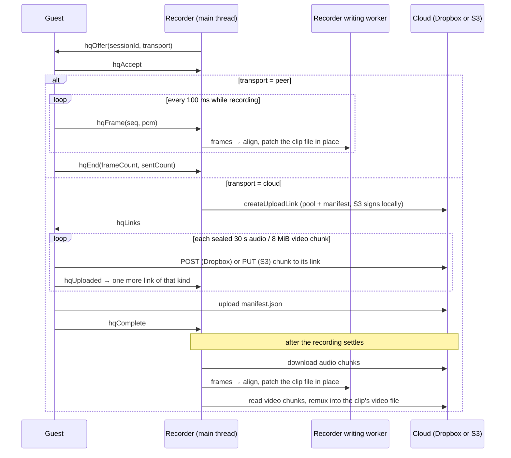

# Meeting high-quality media

> **Revised 2026-11-18** after backup moved from Dropbox-only to cloud storage (`src/backup/CloudStorage.ts`, uncommitted on top of `c3f051e`). Dropbox and S3-compatible storage (Amazon S3, R2, B2, MinIO) now share one `CloudStorage` interface. This plan builds on that interface:
> - The `'dropbox'` transport is now **`'cloud'`**. It uses whichever provider the recorder selected for backup.
> - Step 3 adds upload links and folder listing to `CloudStorage`. On Dropbox these are one-time temporary upload links; on S3 they are presigned PUT URLs, signed locally with no API call.
> - Chunks are verified against `ContentHasher` digests in the manifest (the renamed `DropboxContentHasher`). On S3, where listings carry no content hash, the video is hash-checked by streaming it once before the call video is deleted.
> - `stopAndWaitForRecordings` call sites in backup moved to `src/ui/CloudBackupController.ts`.
>
> **Revised 2026-11-17 against `c3f051e`** for four new constraints:
> 1. A device stores at most one copy of any media.
> 2. At most one high-quality stream leaves each device.
> 3. A recorder connected to cloud backup gives guests upload URLs. Guests upload their high-quality media there while the recorder records the call. After the recording, the recorder replaces its local recording with the cloud version.
> 4. Without cloud backup, guests stream high-quality audio to the recorder over WebRTC, as before.
>
> Changes from the 2026-11-12 revision:
> - **Upgrades happen in place.** HQ audio is mixed into the recorded clip's own audio file, so there is no spool, no second "(high quality)" clip and no copied video. The swap is no longer undoable.
> - **Recorders start sessions** by sending offers. Each device serves one recorder at a time.
> - **A new cloud transport** carries HQ audio and camera video as chunk files. The HQ video replaces the recorded call video.
> - **Alignment is streaming**, so peer audio is patched while the recording is still running.
> - **`stopAndWaitForRecordings` becomes `withRecordingsStopped(operation)`.** It pauses upgrades while a project is switched, exported or backed up.
> - Anchors are refreshed for the 14 commits after `8fa7c80`. Among them, `stopAndWaitForRecordings` moved to `src/recording/UnsettledRecordings.ts`, and the initial-bundle budget (`src/BundleSize.test.ts`) now applies.

## Context

While someone in a meeting (`src/remote/*`) records, each other member sends that recorder high-quality media of itself. The WebRTC media connection carries only the conversation. The recorder records the call as it does today: one linked audio+video clip per person (`Recorder.connectRecording`). It then upgrades each guest's clip with that guest's high-quality media.

**What counts as a copy:**
- Any bytes of the same media stored on the device (OPFS or IndexedDB), at every moment, not just at rest.
- Bounded in-memory working sets don't count. These are: ≤ 80 s of HQ audio per session in the patch service, two downloaded chunks during an upgrade, and the guest's peer-transport send queue (≤ 30 min, as before).
- **Recorder:** the recorded clip is the one copy.
  - HQ audio is mixed into the clip's file in place.
  - HQ video replaces the recorded call video, which is deleted *before* the HQ video is written. The fallback is the cloud copy, verified by content hash before anything is deleted.
- **Guest:** the upload spool holds only chunks not yet uploaded. It exists only while the guest is not recording itself; its own recording already holds its media.
- The cloud provider holds the cloud copy, which is not local.

**Choices made:**
- **Transport:** the recorder picks one per session.
  - **Cloud** when the provider selected for backup (`getSelectedProvider()`) is connected (`isProviderConnected`).
  - **Peer** (the existing peerjs data connection) otherwise.
- **Peer transport: HQ audio only.** The recorded call video is kept. HQ video over the mesh would have to be stored on the recorder next to the call video it is recording.
- **Cloud transport: HQ audio plus camera video** while the camera is on.
- **One target per device:**
  - A guest serves the first offer it accepts and declines the rest with `'busy'`.
  - A member that is recording declines cloud offers, because spooling for upload would be a second local copy. It still accepts peer offers.
  - The recorder itself never sends.
- **Formats:**
  - Audio: 16-bit PCM, mono, 48 kHz, in 100 ms frames, taken from the processed mic track that goes to WebRTC.
  - Video: a fragmented MP4 from `VideoTrackRecorder` (same codecs and quality as local recording). It is timestamped on the guest's HQ audio capture clock, so one alignment places both.
- **Alignment:**
  - The recorder's own Opus recording of the guest is the timing reference, as before: sample-accurate cross-correlation of 5 s blocks. `PeerNetworkDelayEstimator` is not used.
  - It is now streaming, so the peer transport patches during the recording.
  - Video timestamps go through the same piecewise mapping. Clock drift and jitter-buffer shifts that the audio follows are applied to the video too.
- **Replacement:** in place. The Opus audio stays wherever HQ frames are missing, with 5 ms crossfades at run edges.
  - The clip, its clip views, its transcript and the undo history are untouched.
  - Undo cannot bring back the call-quality audio, because it is overwritten.
- **Pause:** peers must be told when the recorder pauses. A session ends at a pause, and the recorder offers a new one when it resumes.
- **Pacing:**
  - Peer frames go out at ≤ 1.5× real time while the recorder records (unchanged).
  - Cloud uploads go one at a time, ≥ 5 s apart while live, so a catch-up burst can't crowd out the call. Both limits drop once the session ends.
- **Storage:**
  - Patching audio never grows a file.
  - Video replacement needs space for the HQ video minus the call video it replaces, plus headroom.
  - Guest spool writes that hit the quota end the session.



**Facts the design depends on:**
- **peerjs data connection (1.5.5):**
  - BinaryPack serialization, reliable but unordered (`ordered:false`).
  - Messages over 16300 B are split and arrive as `Uint8Array`.
  - `send()` applies no backpressure; `dataConnection.dataChannel?.bufferedAmount` is available.
  - It runs on its own RTCPeerConnection, separate from media.
- **Recording (`src/recording`):**
  - Contexts run at 48 kHz.
  - A remote audio input's id is the peer id, and the guest's video input shares it (`VideoInputs.gather`), so both go into one clip. Guest screen shares use `${peerId}-screen`, which is never a member id.
  - Audio is headerless float32 (`clip.filename`) plus `${filename}_summary`, holding int16 [max, min] pairs per 256-sample bucket per channel (`Summary.SAMPLES_PER_SUMMARY`).
  - Video is fragmented MP4 sidecars `${filename}_video_${index}`, listed in `clip.videoSegments`. `VideoFrameResolver` already resolves several segments per clip.
  - **`Clip.length` is `max(summary.length, videoLength)`; the audio length is `clip.summary.length`.**
- **Writing worker:**
  - All recordings write through one shared worker (`Recorder.getWritingWorkerController()`, running `AudioContextControlledWorkerScript.js`).
  - Each `AudioFileWriter` holds exclusive sync handles on its clip's audio and summary files until the job ends.
  - The writer-side `Summary` allocates its chunks as SharedArrayBuffers and posts them to the main thread. Bucket rewrites in the worker are therefore visible to the UI immediately.
- **File locks:**
  - Playback (`AudioFileCache`, cached until `PlaybackJob` ends), rendering and transcription open `getReadOnlySyncAccessHandle`. These shared locks exclude the exclusive handle a patch needs, and vice versa.
  - `FileSystemFileHandle.getFile()` works while a sync handle is open. The spectrogram already reads recording tails this way (`SpectrogramService.ts:579`). Such a `File` becomes unreadable once the file changes.
- **Cloud storage** (`src/backup/CloudStorage.ts`):
  - `CloudStorage` addresses files by `/`-separated paths. Implementations: `DropboxStorage` (App Folder) and `S3Storage` (bucket plus optional key prefix). `getCloudStorage(provider)`, `getSelectedProvider()` and `isProviderConnected(provider)` live in `CloudProviders.ts`.
  - Requests retry transient failures themselves. They fail with `CloudAuthorizationError`, `CloudUnavailableError`, `CloudStorageFullError` or `CloudError` (`service`, `reason`), whatever the provider.
  - `ContentHasher` (`ContentHasher.ts`) computes SHA-256 of each 4 MiB block, then SHA-256 of the block digests. This is Dropbox's content hash, and backup indexes use it for every provider.
  - `CloudBackup.listBackups` skips root folders without `backup.json` (`readListing` returns null when `readFile` finds nothing), so a `/Meeting media` root folder is ignored by backups.
- **Dropbox** (App Folder app, `token_access_type: 'online'`, so tokens last about 4 h with no refresh):
  - `POST /2/files/get_temporary_upload_link {commit_info, duration ≤ 14400}` returns a one-time `link` and needs `files.content.write`, which backup already uses. Errors with the commit info surface only when the link is consumed, as a generic 409.
  - Consuming a link: `POST <link>` with `Content-Type: application/octet-stream` (or `text/plain`) returns `{"content-hash": …}`. 409 means unavailable or failed; 410 means expired or consumed.
  - With `mode: 'add'`, re-uploading identical bytes is not a conflict.
  - Community reports show browser XHR uploads to these links working, and 413s for large bodies. Chunks stay ≤ 8 MiB. CORS is verified in step 3.
  - `files/list_folder` returns each file's `size` and `content_hash`.
- **S3** (long-term access key and secret in IndexedDB; requests are signed by `S3Signer.ts` with AWS Signature Version 4):
  - A presigned URL signs the request into its query (`X-Amz-Algorithm`, `X-Amz-Credential`, `X-Amz-Date`, `X-Amz-Expires` ≤ 604800, `X-Amz-SignedHeaders=host`, payload `UNSIGNED-PAYLOAD`). Creating one is local and free, and it can be used any number of times until it expires.
  - A `PUT` overwrites the object. A presigned `PUT` fails with 403 (`AccessDenied`, `SignatureDoesNotMatch`, or `Request has expired`) once its URL is no longer valid.
  - `ListObjectsV2` returns each key's `Size` and `ETag`. The `ETag` is an MD5 only for unencrypted single-part uploads, so it is not a content hash the recorder can check.
  - The bucket's CORS rules, which backup already needs, allow the app's origin to `PUT` with any header. That origin is the same on guests.
- **mediabunny 1.45:**
  - Non-CMAF fragmented MP4 writes sequentially. The only exception is the final 4-byte `mfro` size patch at the very end (`isobmff-muxer.js` finalize).
  - `EncodedPacketSink`, `EncodedVideoPacketSource`, `EncodedPacket.clone({ timestamp })` and `CustomSource({ getSize, read, prefetchProfile })` exist.
- **Bundle:** `src/BundleSize.test.ts` caps up-front JavaScript at 550 000 bytes. All new code sits behind the existing lazy imports (meeting, recorder) or new dynamic imports, except a few lines in `UnsettledRecordings.ts`, `ProjectManager.ts`, `Clip.ts` and `FileSystemUtils.ts`.

**Constants** (one place each, named exactly):

| Name | Value | File |
|---|---|---|
| `HQ_SAMPLE_RATE` | 48000 | `src/remote/HighQualityAudioFormat.ts` |
| `HQ_FRAME_SAMPLES` / `HQ_FRAME_BYTES` | 4800 (100 ms) / 9600 | same |
| `HQ_MAX_FRAME_SEQ` | 864000 (24 h) | same |
| `HQ_AUDIO_CHUNK_FRAMES` | 300 (30 s) | same |
| `HQ_AUDIO_CHUNK_HEADER_BYTES` | 16 | same |
| `HQ_VIDEO_CHUNK_BYTES` | 8388608 (8 MiB) | same |
| `HQ_CLOUD_ROOT` | `'/Meeting media'` | same |
| `HQ_UPLOAD_SPOOL_DIRECTORY` | `'meeting-hq-upload'` | same |
| `HQ_MAX_BUFFERED_BYTES` | 32768 | `src/remote/PeerAudioTransport.ts` |
| `HQ_MAX_QUEUED_FRAMES` | 18000 (30 min) | same |
| `HQ_MAX_FRAMES_PER_PUMP` | 4 | same |
| `HQ_PUMP_INTERVAL_MS` | 50 | same |
| `HQ_LIVE_FRAMES_PER_SECOND` | 15 (1.5× real time) | same |
| `HQ_UPLOAD_MIN_INTERVAL_MS` | 5000 | `src/remote/CloudMediaTransport.ts` |
| `HQ_LEAVE_TIMEOUT_MS` | 10000 | `src/remote/HighQualityMediaSender.ts` |
| `HQ_OFFER_TIMEOUT_MS` | 10000 | `src/remote/HighQualityMediaReceiver.ts` |
| `HQ_LINK_POOL` | `{ dropbox: 3, s3: 20 }` per kind | same |
| `HQ_LINK_DURATION_SECONDS` | `{ dropbox: 14400, s3: 86400 }` | same |
| `HQ_STALE_UPLOAD_MS` | 600000 (10 min) | `src/remote/MeetingMediaUpgrade.ts` |
| `HQ_POLL_INTERVAL_MS` | 120000 | same |
| `HQ_MAX_INFLIGHT_FRAMES` | 600 | same |
| `HQ_STORAGE_HEADROOM_BYTES` | 268435456 (256 MiB) | same |
| `HQ_PATCH_RETRY_MS` | 1000 | `src/recording/HighQualityPatchService.ts` |
| `READ_ONLY_OPEN_RETRY_MS` / `READ_ONLY_OPEN_TIMEOUT_MS` | 50 / 1000 | `src/filesystem/FileSystemUtils.ts` |
| `BLOCK_FRAMES` / `BLOCK_SAMPLES` | 50 / 240000 (5 s) | `src/remote/HighQualityAlignment.ts` |
| `DECIMATION` | 6 | same |
| `MIN_CORRELATION` | 0.5 | same |
| `SILENCE_RMS` | 0.00316 (−50 dBFS) | same |
| `NARROW_SEARCH_SAMPLES` / `WIDE_SEARCH_SAMPLES` | 12000 / 96000 | same |
| `FINE_SEARCH_SAMPLES` | 12 | same |
| `RESYNC_TOLERANCE_SAMPLES` | 480 (10 ms) | same |
| `INTERPOLATION_TOLERANCE_SAMPLES` | 4800 (100 ms) | same |
| `CROSSFADE_SAMPLES` | 240 (5 ms) | same |
| `MAX_HELD_BLOCKS` | 12 (60 s) | same |
| `REORDER_SLACK_BLOCKS` | 1 | same |

## Approach

Do the steps in this order; the tree builds after each one. Dependencies:
- Steps 3, 4 and 5 are independent of each other.
- Step 6 needs 5, and step 7 needs 6.
- Step 8 needs 2, 3 and 4.
- Step 9 needs 2, 3, 6 and 7.
- Step 10 needs 3, 6 and 9.
- Step 11 needs 8 and 9.

### 1. Make recording pause visible to peers
Unchanged from the previous revision; the anchors still hold at `c3f051e`.
- `src/remote/RemoteMediaClient3.ts` `RecordingActivity` (`:63-76`): add `| { state: 'paused'; countdownId: number | null }`.
- `MeetingRoomController.setLocalRecordingActivityFromAudioState` (`src/ui/MeetingRoomController.ts:839`):
  - `AudioState.RECORDING` → `{ state: 'recording', countdownId }`. Keep the previous `countdownId` when the previous local state is `countdown`, `recording` or `paused`; otherwise use `null`.
  - `AudioState.RECORDING_PAUSED` → `{ state: 'paused', countdownId: previous }`, **only** when the previous local state is `recording` or `paused`; otherwise leave it unchanged. `AudioControl.replaceAudioContext` (`AudioControl.ts:151`) suspends every new recording context before it starts, so a spurious `RECORDING_PAUSED` fires at the start of every recording.
  - The default branch is unchanged.
- `VideoContainer.setRecordingActivity` (`:93`): add `case 'paused'` to both switches. Announce ``announce(`${username} paused recording`)`` and display ``this.showRecordingActivity(`${username} paused recording`)``.

### 2. HQ messages on the existing data connection (`RemoteMediaClient3.ts`)
- Add to `PeerMessage` (`:6-61`). R = recorder, G = guest.
  ```ts
  | { type: 'hqOffer'; sessionId: string; transport: 'peer' | 'cloud' }                    // R→G
  | { type: 'hqAccept'; sessionId: string }                                                  // G→R
  | { type: 'hqDecline'; sessionId: string; reason: 'busy' | 'recording' | 'noMicrophone' | 'unsupported' } // G→R
  | { type: 'hqCancel'; sessionId: string }                                                  // R→G: stop now, discard, no end message
  | { type: 'hqFailed'; sessionId: string; message: string }                                 // G→R: the guest gave up
  | { type: 'hqFrame'; sessionId: string; seq: number; pcm: ArrayBuffer }                    // G→R, peer
  | { type: 'hqEnd'; sessionId: string; frameCount: number; sentCount: number }              // G→R, peer
  | { type: 'hqLinks'; sessionId: string; links: Array<{ name: string; method: 'POST' | 'PUT'; url: string }> } // R→G, cloud
  | { type: 'hqLinkRequest'; sessionId: string; names: string[] }                            // G→R, cloud
  | { type: 'hqUploaded'; sessionId: string; name: string; size: number; contentHash: string } // G→R, cloud; ContentHasher digest
  | { type: 'hqComplete'; sessionId: string }                                                 // G→R, cloud: manifest uploaded
  ```
- Export:
  - `HighQualityMessage = Extract<PeerMessage, { type: \`hq${string}\` }>`
  - `HighQualityListener = (peerId: string, message: HighQualityMessage) => void`
- Add a module constant `HIGH_QUALITY_MESSAGE_TYPES: ReadonlySet<string>` holding the eleven types.
- New public methods:
  - `addHighQualityListener(listener)`.
  - `sendHighQuality(peerId, message): boolean`. It returns `false` unless `this.admittedPeers.has(peerId)` (`:186`) and there is a `getOpenDataConnection(peerId)` (`:411`).
  - `getSendBufferedAmount(peerId): number | null`. It returns `connection.dataChannel?.bufferedAmount ?? 0`, or `null` without an open connection. Test fakes have no `dataChannel`, so they get 0.
- `handleDataMessage` (`:853`): its first statement, before the `console.debug(… JSON.stringify(data))` at `:854`, reads `(data as {type?: unknown} | null)?.type`.
  - If that is in the set: call every listener with `(self.peer, data)` when `this.admittedPeers.has(self.peer)`, then `return`.
  - HQ messages are never held for unadmitted peers, never stringified, and never reach the `unrecognized message` default (`:937`).
- An older build that receives `hqOffer` logs it as unrecognized and never answers. The recorder's offer timeout covers that.
- Delete `src/remote/RemoteRecorder.ts`. It is an unused `MediaRecorder` stub that nothing imports.

### 3. Upload links and file listings in `CloudStorage`, and the link spike
- Add to `CloudStorage` (`src/backup/CloudStorage.ts:24`):
  ```ts
  export interface UploadLink {
    readonly method: 'POST' | 'PUT'
    readonly url: string
    /** Takes one upload (Dropbox); otherwise any number until it expires (S3). */
    readonly singleUse: boolean
  }
  export interface CloudFile {
    readonly name: string
    readonly size: number
    /** The `ContentHasher` digest, when the provider reports one. */
    readonly contentHash: string | null
  }
  /** A URL that uploads the file at `path` without credentials, valid for up to `seconds`. */
  createUploadLink(path: string, seconds: number, signal?: AbortSignal): Promise<UploadLink>
  /** The files directly in `folder`, or null when it holds none or does not exist. */
  listFiles(folder: string, signal?: AbortSignal): Promise<CloudFile[] | null>
  ```
- **Dropbox** (`DropboxApi.ts`, `DropboxStorage.ts`):
  - `getTemporaryUploadLink(path, duration, signal?)` calls `request(\`${API_URL}/files/get_temporary_upload_link\`, { json: { commit_info: { path, mode: 'add', autorename: false, mute: true }, duration } })` and validates `link` as a string.
  - `createUploadLink` returns `{ method: 'POST', url, singleUse: true }`, with `duration = min(seconds, 14400)`.
  - `listFiles` uses `files/list_folder` plus `/continue`, keeping files only, with `contentHash = content_hash`. It returns `null` when `isNotFound`.
- **S3** (`S3Signer.ts`, `S3Storage.ts`):
  - `presignS3Url({ method, host, path, query }, credentials, date, seconds)` adds `X-Amz-Algorithm=AWS4-HMAC-SHA256`, `X-Amz-Credential`, `X-Amz-Date`, `X-Amz-Expires` and `X-Amz-SignedHeaders=host` to the query. It signs with payload `UNSIGNED-PAYLOAD` and appends `X-Amz-Signature`. It shares the canonical-request and signing-key code with `signS3Request`.
  - `createUploadLink` returns `{ method: 'PUT', url, singleUse: false }`, with `seconds` capped at 604800. It makes no request.
  - `listFiles` uses `ListObjectsV2` with `prefix = <folder key>/` and `delimiter = /`. It returns `{ name, size, contentHash: null }` per `Contents` entry, or `null` when there are none, since S3 has no empty folders.
- **Guest upload** (`src/remote/CloudUploadLink.ts`; it imports only `waitBeforeRetry`, so guests load no provider code):
  - `uploadToLink(link, bytes, signal?): Promise<string | null>`:
    - does `fetch(link.url, { method: link.method, body: bytes, headers: { 'Content-Type': 'application/octet-stream' }, credentials: 'omit' })`;
    - returns Dropbox's `json['content-hash']` for `POST`, and `null` for `PUT`;
    - retries `TypeError`, 429 and 5xx through `waitBeforeRetry`;
    - throws `new UploadLinkUnusableError(status)` (exported) on 409 or 410 (Dropbox) and on 403 (an expired or refused S3 URL).
  - `isAllowedUploadUrl(url, sessionOrigin): boolean` is true iff the protocol is `https:` (or `http:` on a loopback host) and `new URL(url).origin == sessionOrigin`.
    - The first link of a session sets `sessionOrigin`. Guests never upload a session's media to a second origin.
    - A custom S3 endpoint can be any origin, so this limits a malicious recorder to one HTTPS origin per session. It cannot pin the guest to one service.
- **Spike (do it now, record the results in this file):** run `yarn dev` in Chrome and Firefox. Upload 8 MiB of random bytes from the page console:
  - **Dropbox:** get a link and POST to it. Confirm:
    - the response is readable cross-origin, and its `content-hash` matches `contentHash` (`ContentHasher.ts`);
    - re-uploading the same bytes through a fresh link for the same path succeeds;
    - reusing a consumed link returns 410.
  - **S3:** PUT to a presigned URL on a bucket with the README's CORS rules (Amazon S3, plus MinIO or R2). Confirm:
    - the PUT succeeds, and a second PUT to the same URL replaces the object;
    - a URL past `X-Amz-Expires` returns 403.

### 4. Guest capture
- **`src/remote/HighQualityAudioFormat.ts`:** the `HQ_*` format and cloud constants from the table.
- **`src/remote/HighQualityCaptureProcessor.js`:** registered as `'HighQualityCaptureProcessor'`. It has no imports, because it is loaded as an asset like `ReportingAudioWorkletProcessor.js`.
  - Constructor: `frameSamples` comes from `processorOptions`; it allocates `buffer = new Int16Array(frameSamples)`, sets `index = 0`, and sets `frameStart = null`.
  - `process(inputs)`: `channel = inputs[0]?.[0]`. For each of the 128 quantum samples:
    - when `index == 0`, set `frameStart = currentFrame + i`;
    - take `x = channel ? channel[i] : 0`, clamp it to [−1, 1], append `Math.round(x < 0 ? x * 32768 : x * 32767)`;
    - when the buffer is full, `port.postMessage({ pcm: buffer.buffer, frame: frameStart }, [buffer.buffer])`, then allocate a new buffer and reset `index`.
  - Returns `true`.
- **`src/remote/HighQualityAudioCapture.ts`:**
  ```ts
  export interface FrameCapture {
    start(track: MediaStreamTrack): Promise<boolean>
    stop(): void
    /** The capture context's current sample frame, or null when stopped. */
    position(): number | null
  }
  export class HighQualityAudioCapture implements FrameCapture {
    constructor(private readonly onFrame: (pcm: ArrayBuffer, contextFrame: number) => void) {}
  }
  ```
  `start` runs these steps in order:
  1. `stop()`, then `generation = ++this.generation`.
  2. Create the context with `new AudioContext({ sampleRate: HQ_SAMPLE_RATE })`.
  3. `addModule(new URL('./HighQualityCaptureProcessor.js', import.meta.url))`.
  4. `createMediaStreamSource(new MediaStream([track]))`.
  5. Create the node: `new AudioWorkletNode(ctx, 'HighQualityCaptureProcessor', { numberOfInputs: 1, numberOfOutputs: 0, channelCount: 1, channelCountMode: 'explicit', processorOptions: { frameSamples: HQ_FRAME_SAMPLES } })`.
  6. `port.onmessage` forwards `(e.data.pcm, e.data.frame)` only while the generation is current.
  7. Connect the source to the node, then `await ctx.resume()`.
  8. Return `generation === this.generation && ctx.state === 'running'`.

  If any step throws: log through `new Logger('HighQualityAudioCapture').errorMessage`, call `stop()` if the generation is still current, and return `false`. This covers Firefox, which rejects mismatched sample rates.
  - `position()` returns `Math.round(ctx.currentTime * HQ_SAMPLE_RATE)`.
  - `stop()` does `++generation`, `audioContext?.close()`, `audioContext = null`.
  - The capture uses its own context, never `AudioControl`'s, because that context is replaced on every play/record/monitor change.

### 5. Streaming alignment (`src/remote/HighQualityAlignment.ts`, pure; the patch service and tests use it)
It uses `fft.js` as in `src/transcription/GraniteCtc.ts:1`. `realTransform` fills only half a spectrum, so call `completeSpectrum` before multiplying; `inverseTransform` already divides by N.
```ts
export interface PatchSpan {
  filePosition: number; sessionSample: number; length: number
  runStart: number          // file position where this span's run starts
  runEnd: number | null     // file position where it ends, when known
}
export interface Run { sessionSample: number; filePosition: number; length: number }
export type ReadOpus = (start: number, end: number) => Float32Array   // zeros outside [0, available)
export class StreamingAligner {
  constructor(options: { priorFrame: number; segmentStart: number })
  addFrame(seq: number, pcm: Int16Array): boolean   // false: duplicate, seq > HQ_MAX_FRAME_SEQ, or its block already final
  setSegmentEnd(end: number): void
  finish(frameCount: number): void                  // no frame ≥ frameCount will come; frames still missing never will
  advance(readOpus: ReadOpus, opusAvailable: number): PatchSpan[]   // everything that became ready, in file order
  samples(span: PatchSpan): Float32Array            // int16/32768; zeros for missing frames
  release(sessionSample: number): void              // drop frames below this session sample
  readonly finished: boolean                        // finish() was called and every block was emitted
  readonly stats: { blocks: number; confident: number; hqSamples: number }
  readonly runs: readonly Run[]                     // every emitted run, for video mapping
}
export function mixSpan(output: Float32Array, span: PatchSpan, hq: Float32Array): void
export function mapSessionSample(runs: readonly Run[], sessionSample: number): number | null
```
- **Block finality.** Block `b` holds frames `[50b, 50b + 50)`. It is final when `finish()` was called, or when a frame with `seq ≥ (b + 1 + REORDER_SLACK_BLOCKS)·50` has arrived. The peer channel is unordered, but its in-flight window is far below one block.
- **Alignability.** A final block is alignable when the Opus it searches exists: `opusAvailable ≥ min(segmentEnd ?? ∞, pred + 240000 + WIDE_SEARCH_SAMPLES)`.
- **Per alignable block, in order** (as `findBlockOffsets` was in the previous revision):
  1. Fewer than 25 received frames → non-confident.
  2. RMS over the received frames below `SILENCE_RMS` → non-confident.
  3. Prediction:
     - after a confident block `c` with offset `o_c`: `pred = o_c + (b − c)·240000`, radius `NARROW_SEARCH_SAMPLES`;
     - otherwise: `pred = priorFrame + b·240000`, radius `WIDE_SEARCH_SAMPLES`.
  4. `correlate`. If a narrow search fails, repeat it wide around the same `pred`.
  5. The block is confident when `ncc ≥ MIN_CORRELATION`.
- **`correlate`** (unchanged):
  1. Read `opus = readOpus(pred − radius, pred + hq.length + radius)`.
  2. Coarse pass:
     - boxcar-decimate both signals by `DECIMATION`;
     - take the FFT cross-correlation `IFFT(FFT(opD)·conj(FFT(hqD)))` with `N = nextPow2(opD.length + hqD.length)`, at lags `k ∈ [0, opD.length − hqD.length]`;
     - score each lag as `c[k]/sqrt(E[k])` (prefix-sum sliding energy, 0 where `E[k] == 0`) and take the argmax `kBest`.
  3. Fine pass at 48 kHz: the direct normalized cross-correlation at `L ∈ [6·kBest − 12, 6·kBest + 12]`.
  4. Return `{ offset: pred − radius + Lbest, ncc }`.
- **Resolution.**
  - A confident block resolves itself, plus every held block since the previous confident block `p`. Each held block `x` gets the residual `r = o − x·240000`, interpolated between `p` and this block when `|r_n − r_p| ≤ INTERPOLATION_TOLERANCE_SAMPLES`; otherwise it takes the residual of the nearer of `p` and this block.
  - A non-confident block is held.
  - When more than `MAX_HELD_BLOCKS` are held, the oldest resolves with `p`'s residual. With no `p`, it is dropped.
  - On finish, the remaining held blocks take `p`'s residual, or are dropped if there is no `p`.
- **Runs.** These are the cursor rules from the previous revision, applied to resolved blocks in order. A frame's desired position is `o_b + (f − 50b)·4800`.
  - Extend the current run at its cursor when `f` directly follows the run's last frame and `|desired − cursor| ≤ RESYNC_TOLERANCE_SAMPLES`.
  - Otherwise close the run and start a new one at `desired`.
  - Clip runs to `[max(0, segmentStart), segmentEnd ?? opusAvailable)`.
  - When a run closes, drop it if it is shorter than `2·CROSSFADE_SAMPLES`.
- **Emission.** Block `b`'s spans are emitted once block `b + 1` has resolved, or after finish. By then any run ending inside `b + 1` has a known `runEnd`, so fade-outs that start in `b` are correct. Memory is bounded by roughly `MAX_HELD_BLOCKS + 2` blocks, about 7.7 MB.
- **`mixSpan`.**
  - `output` holds the span's current file samples.
  - For `i`, let `j = span.filePosition − span.runStart + i` and `runLength = (span.runEnd ?? Infinity) − span.runStart`.
  - Then `w = min(1, (j + 1)/CROSSFADE_SAMPLES, (runLength − j)/CROSSFADE_SAMPLES)` and `output[i] = output[i]·(1 − w) + hq[i]·w`.
  - Re-running on already-patched audio correlates at the same offsets and writes the same interior samples, so patching is idempotent.
- **`mapSessionSample`.** It returns the file position from the run that covers `sessionSample`, otherwise from the nearest run's offset (preferring the one before). It returns `null` when there are no runs.

### 6. In-place patch service (recorder's writing worker)
Patches must go through the writing worker, because during a recording that worker holds the only writable handle on a guest's audio file.

- **`src/recording/LiveRecordingFiles.ts`** (worker-side registry):
  - `register(key, file)`, `get(key)`, `unregister(key)`, where `key = \`${dirname}/${filename}\``;
  - `file = { handle, summaryHandle, summary, writtenFrames(): number }`.
- **`AudioFileWriter`:**
  - The constructor (`AudioFileWriter.ts:21`) takes `liveKey` and registers itself.
  - The first statement of `runFileWritingLoop`'s `finally` (`:62`) unregisters, before any handle closes.
  - `writtenFrames()` is `this.position / (4·channelCount)`.
  - `AudioFileWritingJob.create` (`AudioFileWritingJob.ts:18`, writer built at `:42`) passes `` `${input.dirname}/${input.clip.filename}` `` and the summary sync handle.
- **`Summary`:**
  - Extract the float→int16 conversion from `summarizeDataInternal` (`Summary.ts:135`) into `static toInt16(value)`.
  - Add `static computeBuckets(samples: Float32Array, channelCount: number): Int16Array`, which returns [max, min] per channel per 256-sample bucket. `samples` starts on a bucket boundary; the last bucket may be partial.
  - Add `overwriteBuckets(firstBucket, values)`:
    - it writes into the in-memory chunks when they cover the range (they are shared with the main thread during a recording);
    - it writes through the summary sync handle at byte `firstBucket·2·channelCount·2`, using `writeValueToDisk`'s (`:206`) short-write check.
- **`src/recording/HighQualityPatchService.ts`** (worker; `AudioContextControlledWorkerScript.js` gains `case 'hqPort': (await import('../recording/HighQualityPatchService.ts')).attachPatchPort(e.data.port)`):
  - Port protocol, main → worker:
    ```ts
    | { type: 'open'; key: string; dirname: string; filename: string; priorFrame: number; segmentStart: number; segmentEnd: number | null }
    | { type: 'frames'; key: string; firstSeq: number; pcm: ArrayBuffer }   // n·HQ_FRAME_BYTES, consecutive seqs, transferred
    | { type: 'segmentEnd'; key: string; end: number }
    | { type: 'finish'; key: string; frameCount: number }
    | { type: 'abort'; key: string }
    | { type: 'pause' } | { type: 'resume' }
    ```
  - Port protocol, worker → main:
    ```ts
    | { type: 'progress'; key: string; patchedStart: number; patchedEnd: number; summaryOnDisk: boolean; heldFrames: number }
    | { type: 'paused' }
    | { type: 'done'; key: string; stats: { blocks: number; confident: number; hqSamples: number }; runs: Run[] }
    | { type: 'failed'; key: string; name: string; message: string }
    ```
  - Each key owns a `StreamingAligner`. Work runs per file under a mutex, as one batch per macrotask. A batch is at most one block, about 30–50 ms of CPU, so a live writer's 64 Ki-sample ring buffer (about 1.3 s) never overruns.
  - **A batch:**
    1. `live = LiveRecordingFiles.get(key)`. If present, borrow its handles and never close them; `available = live.writtenFrames()`.
    2. Otherwise open both files through `FileSystemUtils.getExistingFileHandle` (new; `create: false`) with exclusive `createSyncAccessHandle()`; `available = handle.getSize() / 4`.
       - On `NoModificationAllowedError` (a reader holds the file, e.g. during playback), retry after `HQ_PATCH_RETRY_MS`. Upgrades pause while their clip plays.
       - `NotFoundError` (the clip was deleted) becomes `failed`.
    3. `spans = aligner.advance(readOpus, available)`. `readOpus` is `handle.read` at `start·4`, zero-padded outside `[0, available)`.
    4. Per span:
       - read the file samples, `mixSpan`, write them back (short-write check), `flush`;
       - recompute buckets over the bucket-aligned range around the span from the file's own samples, then `summary.overwriteBuckets`. In closed mode, a `new Summary(1)` with only `setSyncFileHandle` writes the file alone;
       - `aligner.release(span.sessionSample + span.length)`.
    5. In closed mode, close both handles. Post `progress` (with `summaryOnDisk = !live`), and post `done` once `aligner.finished`.
  - `pause` finishes the current batch, starts no more, and replies `paused`. `resume` continues.
- **`Recorder.openHighQualityPatchPort(): MessagePort`** (next to `getWritingWorkerController`, `Recorder.ts:229`):
  - creates a `MessageChannel`;
  - sends `port2` to the writing worker as `{ type: 'hqPort', port }`;
  - returns `port1`.
- **`src/remote/HighQualityPatchClient.ts`** (main thread) wraps a port with typed methods, `pause(): Promise<void>` and per-key callbacks. On `progress`:
  - when `summaryOnDisk`, reload the clip's summary at most every 5 s and on `done`, via `clip.summary.populateFromFile(…getFile() of summary and audio, 1)`;
  - call `trackListController.clipAudioChanged(clip.id)`, at most every 2 s.
- **UI invalidation:**
  - `TrackListController.clipAudioChanged(clipId)` (new) calls `spectrogramService?.invalidateClip(clipId)` and `draw()`.
  - `SpectrogramService.invalidateClip(clipId)` (new, modeled on `setProject` at `:157`) drops cached tiles and failed keys whose key starts with `${clipId}:`, then rebuilds the queue. A tile read that raced a patch and failed comes back.
- **Readers wait instead of failing:** `FileSystemUtils.getReadOnlySyncAccessHandle` (`:48`) retries `NoModificationAllowedError` every `READ_ONLY_OPEN_RETRY_MS`, for up to `READ_ONLY_OPEN_TIMEOUT_MS`. Playback, rendering and transcription then wait out a patch batch.

### 7. Recording registry, upgrade gate, `Recorder` hooks
- **New `src/recording/RecordingSessions.ts`.** It has only type imports, so it stays tiny:
  ```ts
  export interface RecordingSession {
    readonly dirname: string
    readonly clipsByInputId: ReadonlyMap<string, Clip>   // AudioInput.id → its clip; video-only clips absent
    readonly finished: Promise<void>                      // Recorder's `settled`; never rejects
    openPatchPort(): MessagePort
  }
  export class RecordingSessions {
    static addListener(listener: (session: RecordingSession) => void): () => void
    static publish(session: RecordingSession): void
  }
  ```
- **`src/recording/UnsettledRecordings.ts`** (initial chunk, so it stays a few lines):
  - `registerUpgrade(work: { pause(): Promise<void>; resume(): void }): () => void`.
  - `withUpgradesPaused<T>(operation: () => Promise<T>): Promise<T>`:
    - re-entrant through a depth counter;
    - at depth 0 → 1 it awaits `pause()` on every registered upgrade;
    - work registered while paused is paused at once;
    - at 1 → 0 it calls `resume()`.
  - `withRecordingsStopped<T>(operation)`: `await AudioControl.stop()`, await the unsettled recordings, then `withUpgradesPaused(operation)`.
  - Delete `stopAndWaitForRecordings`. Wrap the rest of each of the 7 call sites' work in `withRecordingsStopped`:
    - `ProjectModalController.ts:196, 211, 237`;
    - `ProjectTransferController.ts:36, 76`;
    - `CloudBackupController.ts:204, 262`.

    `CloudBackup.start` resolves when the job finishes or pauses, so a backup is covered for its whole upload.
  - Wrap the two `CloudBackup.resume()` calls (`CloudBackupController.ts:69, 172`) in `withUpgradesPaused`. A patch would otherwise change a file mid-backup, and the backup would fail with "changed during the backup".
- **`Recorder.startRecording`** (`Recorder.ts:42-63`):
  - create `clipsByInputId` and pass it into `connectRecording`;
  - in the audio loop (`:85-121`), call `clipsByInputId.set(audioInput.id, clipView.clip)`;
  - after `await connected` (`:62`): `if (clipsByInputId.size > 0) RecordingSessions.publish({ dirname: project.directoryName, clipsByInputId, finished: settled, openPatchPort: () => Recorder.openHighQualityPatchPort() })`. Hoist `project` from `connectRecording` (`:72`).
  - Guests learn of the recording only after the worker's `ready` resumes the context and `'recording'` goes out, so no offer can precede the publish.

### 8. Guest sender
**`src/remote/HighQualityMediaSender.ts`**, `class HighQualityMediaSender { constructor(transport, deps?); prepareToLeave(): Promise<void>; dispose(): void }`.
- `transport` is structural: `addStateListener`, `addHighQualityListener`, `sendHighQuality`, `getSendBufferedAmount`.
- `deps` are injectable for tests: `createCapture`, `createVideoRecorder`, `upload` (default `uploadToLink`), `isLocallyRecording` (default: `AudioControl` state is RECORDING or RECORDING_PAUSED).

**State:**
- `active: { sessionId, recorderPeerId, transport: PeerAudioTransport | CloudMediaTransport, firstFrame: number | null, nextSeq: number } | null`, at most one, which is constraint 2;
- `micTrack`, `lastMembers`, `disposed`.

**`hqOffer` from `peerId`:**
- decline `'busy'` when `active` belongs to another session;
- decline `'noMicrophone'` without a live mic track (`LocalMediaStreams.localAVDeviceMediaStream.getAudioTracks()[0]`);
- for `'cloud'`:
  - decline `'recording'` when `isLocallyRecording()` (constraint 1);
  - decline `'unsupported'` without `navigator.storage?.getDirectory`;
- otherwise:
  - create the transport;
  - `capture.start(micTrack)`. On `false`, send `hqFailed` and clear the session;
  - on success, send `hqAccept`.
- On each `onFrame(pcm, contextFrame)`:
  - set `firstFrame ??= contextFrame`;
  - `transport.addFrame(nextSeq++, pcm)`.

**End triggers.** Reconcile on every state update, on `registerAVDeviceListener` audio-track changes, and on `AudioControl` changes. The session ends when:
- the recorder's `recordingActivity.state` is no longer `'recording'`;
- the recorder left;
- the mic track changed;
- the guest started recording itself during a cloud session, which sends `hqFailed('recording started')`;
- or on `hqCancel`, which discards everything with no end message.

Ending stops the capture and calls `transport.end()`. The recorder re-offers if it is still recording.

**`src/remote/PeerAudioTransport.ts`** is the previous revision's sender, cut down to one session:
- **Queue:** `queue` with `HQ_MAX_QUEUED_FRAMES`, dropping the oldest and logging once.
- **Pump:** at most `HQ_MAX_FRAMES_PER_PUMP` frames per `HQ_PUMP_INTERVAL_MS` tick, and only while `bufferedAmount < HQ_MAX_BUFFERED_BYTES`.
- **Credit pacing while live:** `credit = min(4, credit + Δms·HQ_LIVE_FRAMES_PER_SECOND/1000)`.
- **Failures:** `null` buffered or a failed send drops the session.
- **End:** once ended and drained, it sends `hqEnd {frameCount: nextSeq, sentCount}`.

**`src/remote/CloudMediaTransport.ts`:**
- **Spool:**
  - directory `` `${HQ_UPLOAD_SPOOL_DIRECTORY}/${sessionId}` ``, written with `FileSystemUtils.createFileWriter`;
  - the transport holds the Web Lock `'soundetch-hq-upload'` (shared) while it has files;
  - the sender's constructor deletes `HQ_UPLOAD_SPOOL_DIRECTORY` only when it gets that lock exclusively with `ifAvailable`, which clears leftovers from closed tabs.
- **Audio chunks:**
  - frames accumulate in memory, up to `HQ_AUDIO_CHUNK_FRAMES` or a seq gap;
  - the chunk is written as `audio-NNNNN.pcm` (5-digit 1-based ordinal) with a 16-byte header: `'SEHQ'`, u16 version 1, u16 0, u32 firstSeq, u32 frameCount, all little-endian. The int16 frames follow;
  - the chunk is sealed, which queues it for upload.
- **Video:**
  - `createVideoRecorder` builds a `VideoTrackRecorder` with `output: { kind: 'sink', open: () => new ChunkedUploadSink(…) }` (refactor below), `minimumHeight: 0` and `timeline: () => ({ seconds: (capture.position()! − firstFrame) / HQ_SAMPLE_RATE, running: true })`;
  - it attaches `LocalMediaStreams.localAVDeviceMediaStream`'s live video track whenever one exists. The existing pump writes black frames while the camera is off;
  - with no camera at all, no file is ever opened, and the manifest has `video: null`.
- **`src/remote/ChunkedUploadSink.ts`** implements `VideoByteSink` over `video-NNNNN.part` files of `HQ_VIDEO_CHUNK_BYTES`:
  - a write spanning a boundary is split;
  - chunk `k` is sealed once a write begins at or past `(k + 1)·HQ_VIDEO_CHUNK_BYTES`;
  - writing into a sealed chunk throws. That never happens with the non-CMAF fragmented muxer, whose only backward write is the last 4 bytes;
  - `close()` seals the last chunk.
- **Links:** `links: Map<name, { method, url, singleUse }>`, filled from `hqLinks`. Entries that fail `isAllowedUploadUrl` against the session's origin are dropped and logged.
- **Uploader:** one upload in flight, oldest sealed chunk first.
  - While the session is live, starts are at least `HQ_UPLOAD_MIN_INTERVAL_MS` apart, which caps catch-up near 3× the media rate.
  - Per chunk:
    1. Take its link. If there is none, send `hqLinkRequest([name])` (debounced) and wait.
    2. Read the file, compute `contentHash` (`ContentHasher.ts`), then `upload(link, bytes)`.
    3. If the upload returned a hash (Dropbox), it must match. Then send `hqUploaded {name, size, contentHash}`, delete the spool file, and forget the link. A retry after a lost response reuses an S3 link; on Dropbox the consumed link answers 410, which is the unusable case below, and re-uploading identical bytes is not a conflict.
  - `UploadLinkUnusableError` → forget the link and request a new one. Three in a row for one name → `hqFailed('The cloud storage rejected the upload; it may be full or the link expired.')`.
  - `CloudUnavailableError` (retries exhausted) → wait 30 s and retry.
  - Any spool write error, including `QuotaExceededError` → `hqFailed(…)`, delete the spool, and stop.
- **`end()`:**
  1. `await videoRecorder?.finish()`, then seal the open audio chunk.
  2. Send `hqLinkRequest` for every sealed name that has no link.
  3. Upload everything back to back.
  4. Upload `manifest.json` (≤ 1 MiB):
     ```ts
     { format: 'soundetch-meeting-media'; version: 1; sessionId: string; frameCount: number
       audio: Array<{ name: string; firstSeq: number; frameCount: number; size: number; contentHash: string }>
       video: { codec: string; size: number; chunks: Array<{ name: string; size: number; contentHash: string }> } | null
       complete: boolean }   // false when frames were dropped or the video recorder failed
     ```
     Its link is issued at session start, so a guest that already left can still write it.
  5. Send `hqComplete` if still connected, then delete the session's spool directory and release the lock.
- **`cancel()`:** stop everything and delete the spool.
- **Leaving with uploads pending:**
  - `window` `beforeunload` calls `preventDefault()` while any upload is pending;
  - a long notification shows ``Finishing the high-quality upload for ${recorder} (${humanizeBytes(left)} left). Keep this tab open.``

**`prepareToLeave()`:** `end()` the active cloud session, then wait (up to `HQ_LEAVE_TIMEOUT_MS`) until the requested links arrive. Uploads continue after the meeting connection closes.

**`dispose()`:**
- a peer session is dropped;
- a cloud session keeps uploading while its links last; the rest is deleted;
- no messages are sent.

**`VideoTrackRecorder` refactor** (`VideoTrackRecorder.ts`):
- `VideoTrackRecorderOptions` (`:33-44`) replaces `directory`/`filename` with `output: { kind: 'file'; directory: string; filename: string } | { kind: 'sink'; open(): Promise<VideoByteSink> }`, where `VideoByteSink = { write(data, position): Promise<void>; close(): Promise<void> }`.
- `VideoFileWriter` already matches `VideoByteSink`.
- `open` (`:239-248`) uses `VideoFileWriter.open` for `'file'` and `output.open()` for `'sink'`.
- In `finishRecording` (`:102`), segment reading, quota trimming and deletion apply only to `'file'`; a `'sink'` returns `null`.
- `VideoRecordingSession` passes `{ kind: 'file', … }`.

### 9. Recorder-side receiver (`src/remote/HighQualityMediaReceiver.ts`)
`class HighQualityMediaReceiver { constructor(client: RemoteMediaClient3); dispose(): void }`.

- **New `src/project/MeetingMedia.ts`**, persisted on the clip (`Clip.meetingMedia: MeetingMedia | null = null`, after `Clip.ts:16`; legacy records restore as `null`):
  ```ts
  export interface MeetingMediaSession {
    readonly sessionId: string
    /** The cloud provider that holds this session's files; folders are paths within it. */
    readonly provider: CloudProviderId
    readonly folder: string
    readonly priorFrame: number
    readonly segmentStart: number
    segmentEnd: number | null
  }
  export interface MeetingMedia {
    readonly username: string
    readonly sessions: MeetingMediaSession[]
    audio: 'pending' | 'done'
    video: 'pending' | 'replacing' | 'done' | 'kept'
  }
  ```
  Only cloud sessions are persisted. Peer sessions are live-only.
- **Constructor:**
  - `RecordingSessions.addListener`;
  - `client.addHighQualityListener`;
  - `client.addStateListener`, for `lastMembers` and departures;
  - `AudioControl.addAudioControlListener`, for segments and offers;
  - one `HighQualityPatchClient` per recording, opened on publish.
- **On publish:**
  - `peerClips` = the entries whose key is a current member peer id and whose clip has `getChannelCount() == 1`. If it is empty, ignore the recording;
  - otherwise set `current = { session, peerClips, segments: [{ start: 0, end: null }], sessions: Map<sessionId, Incoming>, stopped: false }`;
  - `registerUpgrade` the patch client;
  - `session.finished.then(() => onFinished(rec))`.
- **Segments.** Lengths come from `clip.summary.length`, never `clip.length`.
  - `RECORDING_PAUSED` with an open segment: `end = min(summary lengths)`. Post `segmentEnd` to every live peer key, and set `segmentEnd` on persisted sessions (save the clip).
  - `RECORDING` with a closed segment: push `{ start: max(summary lengths), end: null }`.
- **Offers:**
  - On each `RECORDING` (first and after every resume), and 1 s after a session of a still-recording peer ends:
    - for each `peerClips` peer that is a member and has no live session, send `hqOffer { sessionId: crypto.randomUUID(), transport }`;
    - `transport` is `'cloud'` iff `isProviderConnected(await getSelectedProvider())`; the provider is stored with the session.
  - With no answer within `HQ_OFFER_TIMEOUT_MS`, treat the offer as declined.
  - Declines are logged; a `'busy'` peer gets no re-offer during this segment.
- **`hqAccept`:** create `Incoming { peerId, username, transport, priorFrame: clip.summary.length, segmentIndex, received: Set, frameCount: null, sentCount: null }`.
  - **Peer:** `patch.open({ key: sessionId, dirname, filename: clip.filename, priorFrame, segmentStart: segments[segmentIndex].start, segmentEnd: null })`.
  - **Cloud:**
    1. `folder = \`${HQ_CLOUD_ROOT}/${safe(project.title, 60)} ${startedAt}/${safe(username, 40)} ${sessionId.slice(0, 8)}\``, where `safe` is `ProjectArchive.getSafeFileTitle` cut by code points.
    2. Append the session, with its `provider`, to `clip.meetingMedia` (create it with `audio: 'pending', video: 'pending'`) and save the clip.
    3. Issue links for `audio-00001..`, `video-00001..` (`HQ_LINK_POOL[provider]` each) and `manifest.json`, valid for `HQ_LINK_DURATION_SECONDS[provider]`, through `getCloudStorage(provider).createUploadLink` (at most 4 concurrent requests; S3 signs locally), and send them as `hqLinks`.
- **Peer messages:**
  - **Validation:**
    - `sessionId` must be a known session from the same peer;
    - `seq`, `frameCount` and `sentCount` must be integers in `[0, HQ_MAX_FRAME_SEQ]`;
    - `pcm` is normalized to an `ArrayBuffer` (for a `Uint8Array`, `buffer.slice(byteOffset, byteOffset + byteLength)`) and must be exactly `HQ_FRAME_BYTES`.
  - **`hqFrame`:** ignore duplicates, then `patch.frames({ key, firstSeq: seq, pcm })`, transferred.
  - **`hqEnd`:** record the counts. Once `received.size ≥ sentCount`, or the peer departs, call `patch.finish(key, frameCount ?? max(received) + 1)`.
- **Cloud messages:**
  - **`hqUploaded`:**
    - check the name pattern `^(audio-\d{5}\.pcm|video-\d{5}\.part|manifest\.json)$`;
    - check sizes: audio ≤ 16 + 300·9600, video ≤ 8 MiB, manifest ≤ 1 MiB;
    - send one more link of that kind.
  - **`hqLinkRequest`:** validate the names (ordinal ≤ highest issued + 200), skip in-flight ones, issue the rest and send them.
  - **`hqComplete` / `hqFailed`:** mark the session final (in memory).
  - **Link issuing failures:**
    - `CloudAuthorizationError` shows one ``showErrorMessage(`Reconnect ${CLOUD_PROVIDER_NAMES[provider]} to keep receiving high-quality media from ${names}.`)`` and retries pending requests every 30 s;
    - guests keep spooling meanwhile. S3 links are signed locally, so this happens only when S3 was disconnected.
- **Departures:**
  - Peer sessions are finished with what arrived.
  - Cloud sessions are left to `MeetingMediaUpgrade`'s finality rule, since the guest may still be uploading after leaving.
- **`hqFailed` / `hqDecline`:** shown in the log only. The clip keeps whatever arrives.
- **Patch results:** when every peer session of a clip is `done`:
  - `hqSamples > 0` → ``showLongDurationMessage(`Upgraded ${username}'s recording to high-quality audio (${Math.round(100·hqSamples/summary.length)}% of the recording).`)``;
  - otherwise → ``showLongDurationMessage(`No usable high-quality audio arrived from ${username}; kept the call audio.`)``;
  - `failed` → ``showErrorMessage(`Could not upgrade ${username}'s recording: ${message}`)``.
- **`onFinished(rec)`:**
  - set `stopped`, close the last segment with the exact minimum summary length, and post or save `segmentEnd`;
  - if `current === rec`, set `current = null`;
  - if peer sessions are incomplete, show ``showLongDurationMessage(`Waiting for high-quality audio from ${names}.`)``;
  - for each clip with `meetingMedia`: `(await import('./MeetingMediaUpgrade')).scheduleUpgrade(project, clip, { liveSessions })`. `liveSessions` lets it wait for `hqComplete` and `hqFailed` from guests still in the meeting.
- **`dispose()`:**
  - abort live peer keys, which keeps what was patched;
  - cancel pending link requests;
  - unsubscribe everything.
  - Cloud upgrades that are already scheduled continue; they don't need the meeting.

### 10. Cloud upgrade (`src/remote/MeetingMediaUpgrade.ts`, lazy)
Exports `scheduleUpgrade(project, clip, options?)` and `resumeUpgrades(project)`. Each clip has at most one run at a time, and every run is `registerUpgrade`d.

1. **Finality.** Poll `getCloudStorage(session.provider).listFiles(session.folder)` every `HQ_POLL_INTERVAL_MS`. A session is final when one of these holds:
   - its `manifest.json` exists;
   - it reported `hqFailed`;
   - it is not live, and its listing has been unchanged for `HQ_STALE_UPLOAD_MS`.

   Wait until every session of the clip is final. While waiting, the clip info shows "Waiting for uploads". A run stops polling if the project closes, and `resumeUpgrades` restarts it next time.
2. **Audio** (`meetingMedia.audio == 'pending'`): per session, in order:
   - `patch.open` in closed mode (no live writer; `segmentEnd ?? summary.length`);
   - download audio chunks in ordinal order with `readFile(path)` → `arrayBuffer()`, and check each against the manifest's `size` and `contentHash`; a chunk that fails is skipped like a missing one;
   - check the header, then `patch.frames` with backpressure: keep `posted − patched ≤ HQ_MAX_INFLIGHT_FRAMES`, using `progress.heldFrames`;
   - `patch.finish(frameCount)`, where `frameCount` comes from the manifest, or `max(firstSeq + frameCount)` over the chunks found.

   Then set `audio = 'done'`, save the clip, and show the same "Upgraded … (N%)" message.

   A missing folder (`listFiles` → `null`) sets `audio = 'done'`, `video = 'kept'`, and shows ``showLongDurationMessage(`${username}'s high-quality media is no longer in ${CLOUD_PROVIDER_NAMES[provider]}; kept the recording as is.`)``.
3. **Video** (`meetingMedia.video == 'pending'`). Replace only when every session has a manifest with `complete && video`, every chunk the manifest lists exists with its `size` and `contentHash`, and the session's aligner produced runs. Otherwise set `video = 'kept'`. Skip the step while `clip.videoRecordingInProgress`; `VideoRecovery` runs first on load.
   - Where `listFiles` reports content hashes (Dropbox), they are compared directly.
   - Where it does not (S3), each video chunk is streamed through `ContentHasher` and discarded before anything is deleted. That costs one extra download of the video (about 1.3 GB per guest-hour) and stores nothing.
   1. **Storage:** compute `needed = Σ hq video size − Σ current video file sizes + HQ_STORAGE_HEADROOM_BYTES`. If `navigator.storage.estimate()` shows less free space, keep `'pending'` and show ``showLongDurationMessage(`Not enough browser storage to replace ${username}'s video; free ${humanizeBytes(needed)} and use Finish high-quality upgrade.`)``.
   2. **Commit to replacing:**
      - set `video = 'replacing'` and `videoSegments = []`, keeping `videoLength` so clip views keep their length;
      - save, then `trackListController.draw()`, so nothing references the old files;
      - delete every old `_video_${index}` file.
   3. **Per session `i`, remux into `` `${clip.filename}_video_${1 + i}` ``:**
      - **Input:** `new Input({ source: new CustomSource({ getSize: () => manifest.video.size, read: (start, end) => bytes from chunk files, prefetchProfile: 'network' }), formats: ALL_FORMATS })`. Chunks are downloaded whole through `readFile` and the last two kept in memory. Each one is checked against its manifest `contentHash` again before use: S3 links stay valid after the check, so a chunk could have changed since. A mismatch fails this step.
      - **Track:** `track = (await input.getVideoTracks())[0]`, with `decoderConfig = await track.getDecoderConfig()`.
      - **Output:** an `Output` with `Mp4OutputFormat({ fastStart: 'fragmented' })` and a `StreamTarget` over `VideoFileWriter.open(dirname, name)`, exactly like `VideoTrackRecorder.open`. Add an `EncodedVideoPacketSource(track.codec)` and `start()`.
      - **Packets:** for each packet of `new EncodedPacketSink(track).packets()`:
        - compute `t = mapSessionSample(runs, packet.timestamp·48000)/48000`;
        - add `packet.clone({ timestamp: Math.max(t, last + 0.001) })`, passing `{ decoderConfig }` with the first packet.
      - **B-frames:** if any raw timestamp decreases, the stream has B-frames (the guest encodes with `latencyMode: 'realtime'`, so it shouldn't). In that case, restart this session with the median run offset as a constant shift.
      - **Finish:** `finalize()`, then `readRecordedVideoSegment(dirname, name, 48000)`. Clamp the result to `[segmentStart, segmentEnd)`, adjusting `mediaStartSeconds` by the trimmed start; if nothing remains, delete the file.
   4. Set `videoSegments` (index `1 + i`, `trackNumber: 1`, `mimeType: 'video/mp4'`), `videoLength = max segment end` and `video = 'done'`. Save, `draw()`, and show ``showLongDurationMessage(`Replaced ${username}'s video with the high-quality recording.`)``.
   5. On failure in step 3:
      - delete this run's outputs and leave `'replacing'`; the clip shows no video;
      - show ``showErrorMessage(`Could not finish ${username}'s high-quality video: ${message}. It is safe in ${CLOUD_PROVIDER_NAMES[provider]} under ${folder}; use Finish high-quality upgrade to retry.`)``.
   6. `pause()` during step 3 waits for the session in progress to finish. It never leaves a half-written file behind for an export or backup.
4. **Resume:**
   - In `ProjectManager`, after both `recoverInterruptedVideo(...)` calls (`ProjectManager.ts:89, 164`): if any clip has `meetingMedia` with `audio == 'pending'` or `video` in `'pending' | 'replacing'`, `void import('../remote/MeetingMediaUpgrade').then((m) => m.resumeUpgrades(project))`. This does not block loading.
   - When a session's provider is not connected, show ``showLongDurationMessage(`Connect ${CLOUD_PROVIDER_NAMES[provider]} to finish upgrading ${names}.`)`` once.
5. **Clip info** (`ClipManagerController.openClipInfo`, `:147`):
   - for clips with `meetingMedia`, a "High-quality media" row: `Waiting for uploads`, `Upgraded`, `Audio upgraded; call video kept` or `Video replacement unfinished`;
   - while anything is pending or replacing, a **Finish high-quality upgrade** button calling `scheduleUpgrade(project, clip)`.
6. Cloud files are never deleted by the app. They are the cloud copy.

### 11. Meeting wiring (`src/ui/MeetingRoomController.ts`)
- Fields: `highQualityMediaSender` and `highQualityMediaReceiver`, both `… | null`.
- In `createMeeting` (`:352`) and `joinMeeting` (`:374`), right after `VideoInputs.registerRemoteMediaClient(...)` (`:364`, `:394`), construct both with the new client.
- Rename today's `disconnect()` (`:577`) body to `private disconnectNow()`. It calls `disposeHighQualityMedia()` first, and `pagehide` (`:349`) calls it directly.
- The new `async disconnect()` is still what `index.html:559` calls. It does `await this.highQualityMediaSender?.prepareToLeave()` and then `disconnectNow()`.
- In `stateListener`'s `state.error` branch, call `disposeHighQualityMedia()` before `this.remoteMediaClient = null` (`:599`).

## Critical files & anchors (at `c3f051e`)
- `src/remote/RemoteMediaClient3.ts`:
  - `PeerMessage` 6-61 and `RecordingActivity` 63-76;
  - `admittedPeers` 186 and `getOpenDataConnection` 411;
  - `handleDataMessage` 853, which must route before the stringify at 854;
  - the unrecognized-message default at 937.
- `src/ui/MeetingRoomController.ts`:
  - `setRecordingActivity` 93 and `setLocalRecordingActivityFromAudioState` 839;
  - create/join 352/374, with registration at 364/394;
  - `pagehide` 349, `disconnect` 577, error branch 599.
- `index.html:559`: the Leave button calls `meetingRoomController.disconnect()`.
- `src/recording/Recorder.ts`:
  - `startRecording` 42-63 (owns `settled`);
  - `connectRecording` 65-150, with its audio loop at 85-121;
  - `getWritingWorkerController` 229.
- `src/recording/UnsettledRecordings.ts` 1-20: the gate, plus its 7 callers listed in step 7.
- `src/recording/AudioFileWriter.ts`: constructor 21, `runFileWritingLoop` finally 62.
- `src/recording/AudioFileWritingJob.ts` `create` 18-62.
- `src/audiocontext/AudioContextControlledWorkerScript.js` `onmessage` 5.
- `src/project/Summary.ts`: `summarizeDataInternal` 135, `writeValueToDisk` 206, `addNewChunk` 221 (SharedArrayBuffer chunks), `populateFromFile` 237.
- `src/recording/VideoTrackRecorder.ts`: options 33-44, `finishRecording` 102, `open` 239-248, `readRecordedVideoSegment` 325.
- `src/filesystem/FileSystemUtils.ts`: `getFileHandle` 28 (creates missing files) and `getReadOnlySyncAccessHandle` 48.
- `src/project/ProjectManager.ts`: `recoverInterruptedVideo` 234, its call sites 89/164, `deleteClip` 319.
- `src/backup/CloudStorage.ts`: `CloudStorage` 24, `deleteFolder` 57 (the last member; step 3 adds two after it), errors and `waitBeforeRetry` below it.
- `src/backup/CloudProviders.ts`: `getCloudStorage` 25, `isProviderConnected` 29, `getSelectedProvider` 34.
- `src/backup/DropboxApi.ts` (`request`, `download`, `listFolders`) and `DropboxStorage.ts`; `src/backup/S3Signer.ts` (`signS3Request`) and `S3Storage.ts` (`request`, `list`).
- `src/backup/CloudBackup.ts`: `listBackups` 250 and `readListing` 605.
- `src/ui/timeline/spectrogram/SpectrogramService.ts`: tile keys 754, `setProject` 157.
- `src/ui/timeline/TrackListController.ts` `spectrogramService` 153/490.
- `src/ui/ClipManagerController.ts` `openClipInfo` 147.

## Verification
1. **New `src/remote/HighQualityAlignment.test.ts`** (node).
   - **Fixture** (as before): 60 s of seeded "speech", and an "Opus" signal made from it by delay `D`, a one-pole lowpass and −40 dB noise. `readOpus` is backed by arrays.
   - **Cases:**
     - Constant `D = 7321`, fed all at once then `finish`: every emitted run maps at 7321 ± 2, and spans cover ≥ 95% of `[7321, 7321 + 60 s)`.
     - The same input fed live: frames in 100 ms steps with up to 3-frame reordering, and `opusAvailable` growing at real time plus 7321. The emitted spans equal the all-at-once spans.
     - Drift of `1 + 50e-6`: each run start is within `RESYNC_TOLERANCE_SAMPLES + 2` of the true delay.
     - A 960-sample jump at 30 s: a new run starts within that block, and later runs map within ±2.
     - Frames 100–104 missing: no span covers their file range.
     - 70 s of silence then speech: held blocks beyond `MAX_HELD_BLOCKS` resolve with the later block's residual, and nothing is emitted before the first confident block.
     - An all-zero session emits no spans; `segmentEnd` at 40 s means no span ends past `40·48000`.
     - `mixSpan`: the interior equals HQ, outside the run equals Opus, and both edges ramp over exactly 240 samples, including a fade-out that starts in the previous block's span.
     - `mapSessionSample` inside and between runs.
2. **New `src/recording/HighQualityPatchService.test.ts`** (`GlobalSettings.useMemoryFS = true`; drives `attachPatchPort` over a node `MessageChannel`).
   - **Setup:** a closed clip of fixture Opus written with a real `AudioFileWriter`/`Summary` pair, then patched with the fixture HQ.
   - **Cases:**
     - The file length is unchanged.
     - The interior of each span equals the HQ samples.
     - The summary file equals the one a fresh `Summary` produces from the patched audio.
     - A second identical run leaves the audio byte-identical.
     - A deleted clip reports `failed` (`NotFoundError`) without recreating the file.
3. **New `src/remote/HighQualityMediaSender.test.ts`** (`./FakesForRemoteTests`, `useMemoryFS`, fake timers, fake transport/capture/uploader).
   - **Peer cases:**
     - Frames flow only after accept.
     - Live pacing gives 15 ± 1 frames/s from a 100-frame backlog.
     - `bufferedAmount = 40000` blocks sending.
     - Overflow beyond 18000 frames drops the oldest (`sentCount` 18000 of 18002).
     - A pause sends `hqEnd {frameCount, sentCount}`.
     - The recorder leaving drops the session silently.
   - **Selection:**
     - A second offer while one session is active → `hqDecline 'busy'`.
     - A cloud offer while `isLocallyRecording()` → `'recording'`.
     - Starting to record mid-cloud-session → `hqFailed`, and the spool is deleted.
   - **Cloud cases** (the fake uploader answers like Dropbox for `POST` links and like S3 for `PUT` links):
     - 300 frames make one `audio-00001.pcm` with the right header and size.
     - A link whose origin differs from the session's first link is never used.
     - Dropbox 410 and S3 403 → `hqLinkRequest([name])`, and the retry succeeds.
     - Three unusable answers in a row → `hqFailed`.
     - A Dropbox upload whose returned `content-hash` differs from the chunk's is not reported as uploaded.
     - While live, two uploads start ≥ 5 s apart; after `end()` they run back to back.
     - `end()` requests links for every unlinked name and uploads `manifest.json` last, with matching hashes. The spool directory is then empty.
4. **Extend `src/backup/S3Signer.test.ts`:** `presignS3Url` for `GET /test.txt`, `X-Amz-Expires=86400` at `20130524T000000Z` reproduces the presigned URL in AWS's query-parameter authentication example, whose signature is `aeeed9bbccd4d02ee5c0109b86d86835f995330da4c265957d157751f604d404`.
5. **Extend `src/backup/CloudBackup.test.ts`'s fakes:** `listFiles` and `createUploadLink` on both. An S3 presigned `PUT` to the fake stores the object, and a Dropbox link consumed twice answers 410.
6. **New `src/remote/ChunkedUploadSink.test.ts`:**
   - a 20 MiB sequential write stream produces 8/8/4 MiB chunks, sealed in order;
   - an overwrite inside the open chunk is applied;
   - a write into a sealed chunk throws;
   - `close()` seals the tail.
7. From the repo root, run `yarn vitest run src/remote src/recording src/project src/backup`, then `yarn test`. Everything passes, including `RemoteMediaClient.test.ts`, the `VideoTrackRecorder`/`VideoRecordingSession`/`AudioFileWritingJob` tests after their refactors, and `BundleSize.test.ts`.
8. `yarn build`: tsc and vite succeed, and `dist/assets` contains `HighQualityCaptureProcessor`, the patch-service chunk and `MeetingMediaUpgrade`.
9. **Manual, two Chrome profiles** (`yarn dev`, `http://localhost:5173/soundetch/`; B can be Incognito).
   - **Peer path** (A not connected to any cloud service):
     - A hosts, B joins with mic and camera, A records, and B talks for 60 s.
     - In A's timeline, B's waveform visibly changes about 7 s behind the playhead.
     - B's `chrome://webrtc-internals` data channel runs at about 100 KB/s, and outbound video `frameHeight` stays at its pre-recording value.
     - A pauses for 5 s; B's tile reads "A paused recording", then "A is recording".
     - A stops. Within seconds, "Upgraded B's recording to high-quality audio (N%)" appears with N ≥ 85.
     - The clip keeps its name, its call video and its length.
     - Clip info disk usage equals the recording's size: no extra files in the project's OPFS directory (DevTools → Application → Storage).
     - Pressing play during the upgrade plays normally, and the upgrade finishes after playback stops.
   - **Cloud path, once with Dropbox and once with S3** (Amazon S3, or MinIO with the README's CORS rules): A connects the service in **Import / Export**, and the same session runs with a pause.
     - The service shows `/Meeting media/<project> <time>/B <id>/` (under the S3 folder prefix) twice, one per segment, each with `audio-*.pcm`, `video-*.part` and `manifest.json`.
     - B's OPFS `meeting-hq-upload` is empty after each segment.
     - After A stops, A shows the audio upgrade message, then "Replaced B's video with the high-quality recording".
     - The project directory holds `<id>_video_1` and `<id>_video_2`, no `_video_0`.
     - Lip sync matches the old clip within a frame.
     - The video is visibly sharper when the call had been scaled down. (Force this with DevTools network throttling on B.)
   - **Leaving early:** B clicks Leave right after A stops. B's notification counts down, and A completes after its next poll.
   - **Reload during replacement:** reload A while "Replacing" runs. On load, the upgrade resumes, and the clip ends with HQ video.
   - **Export during upgrade:** export the project while the audio upgrade runs. The export waits for the in-progress batch or video session, and the archive imports cleanly.
   - **Busy:** A and C both record. B serves whoever offered first and declines the other ("busy" in the console).
   - **Credentials lost:** disconnect the service on A mid-recording.
     - The reconnect error appears, and B's spool grows.
     - Reconnect: uploads resume, and the spool drains. With S3, links already issued keep working while A is disconnected.
   - **Storage full:** set "Simulate custom storage quota" on B just above usage during a cloud session.
     - B sends `hqFailed`.
     - A keeps the call media, and the audio chunks already uploaded still upgrade.

## Non-goals
- **HQ video over the peer transport.** It would put the HQ video on the recorder next to the call video it is recording, and add about 2.8 Mbit/s to the mesh.
- **Guest screen-share media** (`${peerId}-screen` inputs).
- **Undoing an upgrade.** The call-quality audio is overwritten, and the call video is deleted before the HQ video arrives.
- **Deleting cloud copies after an upgrade.** The app leaves them; the user can delete `/Meeting media/...`.
- **Offline (refresh) Dropbox tokens.** Meetings longer than the token's roughly 4 h need a reconnect. S3 keys don't expire.
- **Temporary S3 credentials** (`X-Amz-Security-Token`). Only long-term access keys are supported.
- **Resuming a peer session after the recorder reloads.** The rest of that guest's HQ is lost; the call audio stays.

## Assumptions & contingencies
- **Dropbox CORS spike fails** (the response is unreadable cross-origin): upload with `mode: 'no-cors'` and `Content-Type: text/plain`. Both are CORS-safelisted, and the endpoint accepts `text/plain`.
  - The guest can't read the result, so it sends `hqUploaded` without the service's hash.
  - The recorder confirms each name through `listFiles` before refilling links, and the verification in step 10.3 still applies.
- **Alignment thresholds:** if fewer than 50% of speech blocks reach `MIN_CORRELATION = 0.5`, try 0.35. If the constant-delay test then drifts more than 2 samples, keep 0.5 and widen `FINE_SEARCH_SAMPLES` to 24.
- **Firefox and Safari:** if `HighQualityAudioCapture.start` fails there, those guests send `hqFailed` and stay on call quality. `VideoTrackRecorder`'s element-pump fallback covers video without `MediaStreamTrackProcessor`.
- **Upload bursts vs. call quality.** An 8 MiB upload saturates the uplink for a few seconds. TCP filling the uplink buffer is likely to push the call's delay-based congestion control down for those seconds [INFERENCE, unmeasured]. If B's call video degrades during cloud sessions, defer video chunk uploads until `end()`. That adds time after the recording (about 1.3 GB per guest-hour), but no local copies.
- **Dropbox rate limits:** about 4.5 links/min per guest. If 429s appear, raise `HQ_AUDIO_CHUNK_FRAMES` to 600 and `HQ_VIDEO_CHUNK_BYTES` to 16 MiB. Both stay well under the 150 MB single-upload limit. S3 links cost no request.
- **S3 link reuse:** a presigned `PUT` stays valid for `HQ_LINK_DURATION_SECONDS.s3`, so a guest could overwrite a chunk after uploading it. The recorder verifies every chunk against the manifest when it reads it, which catches that; a session's manifest itself is trusted, as the guest is the source of the media anyway.
- **Video replacement is all or nothing** per clip. One session with missing or incomplete video keeps the call video for the whole clip.
- **Memory:** the patch service holds ≤ 80 s of HQ audio per session (≤ 3 guests), and the guest's peer queue holds ≤ 30 min (173 MB) under a stalled channel. Neither is stored.
- **Space use per guest-hour:**
  - Recorder: 0 extra bytes for audio; video changes by the HQ size minus the call size. Both are encoded at about 720p "high", so roughly 0.
  - Guest: only the upload backlog.
  - Cloud: about 346 MB of audio plus about 1.3 GB of video [estimate from mediabunny's bitrate formula]. An S3 upgrade downloads the video once more to verify it.
